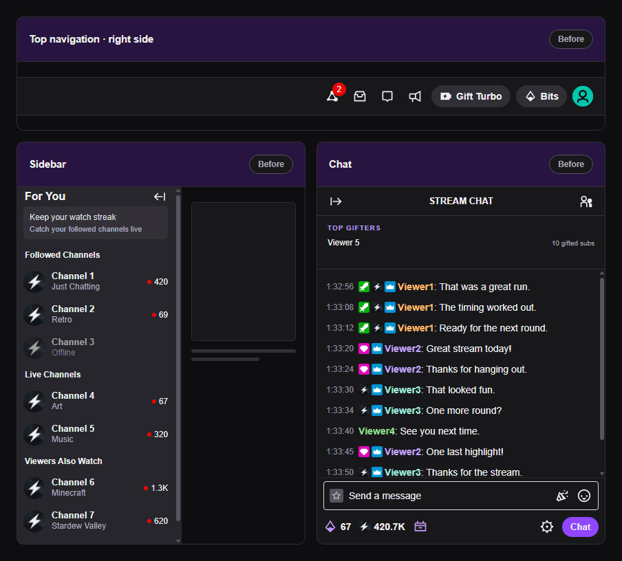

#  twitch-min

A browser extension that hides Twitch promos, shrinks the sidebar, and simplifies chat to keep the video and chat the main focus.



Screenshots: [Before](docs/images/before.png) & [After](docs/images/after.png)

## Install locally

1. Open `chrome://extensions` (Chrome) or `opera://extensions` (Opera GX).
2. Enable **Developer mode**, choose **Load unpacked**, and select this
   repository's **extension** folder.
3. Refresh Twitch tabs. Pin **twitch-min** in the Extensions menu to open settings.

For release ZIPs, follow the included [INSTALL.txt](extension/INSTALL.txt).
Keep the loaded folder in place. After replacing its files, reload the extension
on the extensions page and refresh Twitch. **Remove** uninstalls it and deletes
saved preferences.

## Settings

Changes apply to open Twitch tabs immediately. **Enable twitch-min** pauses or
resumes while keeping your choices; **Enable all settings** turns every option on.
**More settings / Back to top** scrolls the popup.

All options start on except **Hide top navigation bar** and
**About & channel panels**.

| Setting | What it does |
| --- | --- |
| Top navigation extras   | Hide promotional buttons at the top of Twitch. Keep search, notifications, whispers, and your account menu. |
| Hide top navigation bar | Hide the whole bar at the top of Twitch, including search, notifications, and your account menu. |
| Sidebar sections        | Hide the For You section and make the other section headings take up less space. |
| Compact sidebar         | Make the sidebar narrower while keeping channel icons, viewer counts, and game names. |
| Channel action extras   | Hide Share, the three-dot menu, the channel bell, Bits, and Gift a Sub. Keep Follow and subscription icons. |
| About & channel panels  | Hide the About section, channel card, and channel panels below the video. |
| Mouse wheel volume      | Use the scroll wheel over the video to change the volume. |
| Following Stories       | Hide Stories at the top of the Following page. |
| Browse Recent Recaps    | Hide the Recent Recaps section on the Browse page. |
| Chat leaderboard        | Hide the gift rankings, cheer rankings, and goals shown above chat. |
| Shorter chat times      | Show chat times in hours and minutes: `1:32:56` becomes `1:32`, and `5:26` becomes `0:05`. |
| Chat username tint      | Give messages a background tint that matches the username color. Leave highlighted messages unchanged. |
| Group consecutive chats | Show the username and first badge once for groups of messages from the same chatter. |
| Enlarged emote previews | Hover over an emote to see a preview at three times its normal size. |
| Chat message box        | Click **Chat** to show or hide the message box. Press Enter to send. |

The sidebar expands native lists before filtering. Manual Collapse/Expand stays
available; turning both sidebar options off restores an initially collapsed
sidebar.

While enabled, twitch-min also:

- Shows one badge per visible sender header, with other badge names in its native
  tooltip.
- Hides chat headers, replay message menus, and chat scrollbars.
- Hides player Clip, the middle speed display, and Follow/Gift/Subscribe overlays.
- Softens the search border and keeps reward cards in three columns.
- Expands **Show more** in Following's Recommended channels and Latest videos.

Native badge actions, scrolling, collapsed-chat expansion, and playback controls
remain available. Turn a switch off to restore that feature, or pause the extension
to restore everything.

## Privacy and limits

Runs only on `https://www.twitch.tv/*` and `https://twitch.tv/*`. The only API
permission is `storage`, used for local settings. There are no credentials, Twitch
API calls, analytics, backend, remote scripts, or page content uploads. Emote
previews may load larger images from Twitch's CDN. Hidden Twitch features can
still load and run.

Twitch layouts vary by account and language; English label fallbacks may miss
localized controls. Third-party emote markup is not specifically supported.
If a feature misses its target, check its switch and refresh Twitch. Report
reproducible issues with steps and a small sanitized HTML example.

If a toggle cannot be confirmed, the popup shows troubleshooting guidance with
**Copy error details** and a **Report an issue** link. The copied report includes
the extension name/version, requested state, and diagnostic reason. If automatic
copying is unavailable, select and copy the displayed details. Reports are not
uploaded automatically. Refreshing Twitch is a suggested troubleshooting step;
a missing response does not establish why the change could not be confirmed.

For more detail, right-click inside the popup, choose **Inspect**, and filter its
Console for `twitch-min`. Logs distinguish a saved preference from an active-tab
acknowledgement. Twitch's DevTools Console logs page-side application and controller
errors. Logs include the extension name and installed version and stay local.

See [validation notes](docs/validation.md) for tested scenarios and remaining gaps.

## Development

Install Git and a Node.js version that meets `engines.node` in
[package.json](package.json). Install pnpm, then run these commands from the
repository root:

```sh
npm install --global pnpm
pnpm install --frozen-lockfile
pnpm test
```

On Windows, use `pnpm.cmd` if PowerShell blocks `pnpm.ps1`

Puppeteer downloads Chrome for Testing during installation; the unused standalone
Headless Shell download is disabled. Set `CHROME_PATH` to
use another Chrome executable. Browser checks use temporary profiles and offline
fixtures, never your everyday profile. The harness runs Chrome with `--no-sandbox`
and loads trusted fixtures only.

| Command | Purpose |
| --- | --- |
| `pnpm test` | All unit, browser, and packaging checks. |
| `pnpm run test:unit` | Settings, startup, lifecycle, requests, architecture, docs links, image tooling, and version tagging. |
| `pnpm run test:browser` | Feature fixtures, installed-extension storage, and harness regressions. |
| `pnpm run test:package` | ZIP contents and failure recovery. |
| `pnpm run test:soak` | Two-minute message, remount, and pause/resume workload. Set `TWITCH_MIN_SOAK_CYCLES` to change its length. |

Development dependencies are locked in [pnpm-lock.yaml](pnpm-lock.yaml) and excluded
from the installed extension. See [tooling details](docs/architecture.md#development-tooling)
for Puppeteer, Sharp, fflate, and their installation scripts.

### Packaging and CI

Run `pnpm run package` to create `dist/twitch-min-<version>.zip`. It packages
`extension/` and the MIT license, validates assets and ZIP contents, and preserves
the previous archive on failure. The version comes from the matching package and
manifest versions.

[CI](.github/workflows/ci.yml) runs tests and packaging on Linux with the latest
Node LTS and a frozen lockfile. Download and extract its artifact wrapper to get
the installable ZIP. Successful default-branch pushes also create a missing
`v<version>` tag at the tested commit; existing tags are never moved. Packaging
and CI do not publish a GitHub Release or attach the ZIP to the tag.

### Images

After installing development dependencies:

- `node scripts/generate-icons.cjs` regenerates PNG icons from
  `extension/icons/logo.svg`
- `node scripts/capture-previews.cjs` uses Chrome and offline fixtures to regenerate
  the README GIF and PNGs in `docs/images/`

## Reference

- [Architecture](docs/architecture.md): implementation and tooling.
- [Validation](docs/validation.md): recorded results and unverified scenarios.
- [Contributing rules](AGENTS.md): repository working instructions.
- [Roadmap](ROADMAP.md): future work and triggers for deferred refactors.
- [Changelog](CHANGELOG.md): release history.
- [MIT license](LICENSE)


